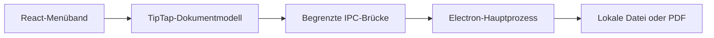

# B&D Word verständlich erklärt

## 1. Was haben wir gebaut?

B&D Word ist ein eigenständiger Desktop-Texteditor: Du kannst schreiben, Text formatieren, Bilder und Tabellen einfügen sowie Dokumente speichern und als PDF ausgeben. Die Bedienung erinnert an Word. **Das Programm ist weder Microsoft Word noch aus dessen Quellcode entstanden.**

Unsere Anwendung besteht aus mehreren Bausteinen:

| Baustein | Einfache Erklärung | Beispiel im Projekt |
| --- | --- | --- |
| TypeScript | JavaScript mit zusätzlichen Typprüfungen. Sie entdecken manche Fehler schon vor dem Start. | Textformatierung und Dokumentkonvertierung |
| React | Bibliothek, die die Oberfläche aus wiederverwendbaren Teilen zusammensetzt. | Menüband, Speicherrückfrage, Statusleiste |
| HTML und CSS | HTML beschreibt die sichtbaren Elemente; CSS ihr Aussehen. | Weißes A4-Blatt, Farben, Abstände, Splash-Animation |
| TipTap / ProseMirror | Eine fertige Open-Source-Grundlage für strukturierte Textbearbeitung. | Markieren, Überschriften, Listen, Undo/Redo |
| Electron | Verbindet eine Chromium-Oberfläche mit lokalen Betriebssystemfunktionen. | Windows-Fenster, Dateidialoge, PDF und Drucken |
| JavaScript / Node.js | Laufzeit für unsere lokalen Desktopfunktionen; die Electron-Dateien sind CommonJS-JavaScript. | Dateien lesen und schreiben |

**Frontend** heißt der Teil, den du bedienst: Buttons, Textfläche und Dialoge. Unser **Backend** ist der lokale Electron-Hauptprozess. Er erfüllt die Aufgaben hinter der Oberfläche. Es gibt dafür keinen Internetserver und keine Datenbank.

Die Verbindung nennt sich **IPC**, also Kommunikation zwischen Prozessen. Beim Speichern bittet die Oberfläche über eine eng begrenzte Brücke um einen Speicherdialog. Der Hauptprozess schreibt die Datei. Die Oberfläche bekommt keinen allgemeinen Zugriff auf Node.js oder das Dateisystem.



### Wie entsteht die Windows-Anwendung?

TypeScript prüft zunächst unsere Typen. Vite übersetzt und bündelt das Frontend zu JavaScript, HTML und CSS. Electron Builder verpackt es mit der Electron-Laufzeit zu einem Windows-Programm. Ein eigenes NSIS-Skript erzeugt zusätzlich den Installer.

Die `.exe` ist deshalb nicht einfach unser TypeScript in Maschinencode. Sie enthält vor allem die Laufzeit, die unseren JavaScript-Code ausführt. Darum ist das Paket wesentlich größer als der eigentliche Editorcode. Windows-Benutzer benötigen weder npm noch einen eigenen Browser zum Starten.

## 2. Welche Rolle spielte REA wirklich?

**Reverse Engineering** bedeutet, ein vorhandenes System anhand seiner Bestandteile oder seines Verhaltens zu untersuchen, um seine Funktionsweise zu verstehen. REA steht für **Reverse Engineer Anything**. Es ist ein Werkzeug, das verschiedene Analysewege bündelt. Es kann beispielsweise Module einer JavaScript-Anwendung untersuchen oder einen gesondert installierten nativen Decompiler ansprechen.

Hier wurde **REA 6.5.0 tatsächlich über seine Kommandozeile verwendet**. Microsoft Word stand nicht als ausführbare Referenz zur Verfügung. Ghidra, Hopper und IDA waren nicht einsatzbereit. Stattdessen untersuchten wir das offene npm-Paket **Quill 2.0.3**, einen Rich-Text-Editor. „Rich Text“ bedeutet: Text kann Eigenschaften wie Schriftgröße und Fettformatierung tragen.

REA las die ausgelieferten JavaScript-Dateien und **Source Maps**. Eine Source Map ordnet erzeugten JavaScript-Code dem ursprünglichen Entwicklungscode zu und kann diesen sogar enthalten. Das ist wie eine mitgelieferte Legende zu einer Karte. Hier war keine Rückübersetzung von Word-Maschinencode nötig.

Die vollständige erste Analyse verarbeitete 199 ausgewählte Quelldateien. Danach wurde die Fettformatierung gezielt untersucht. Der erfolgreiche fokussierte Feature-Trace enthält 16 Knoten und 18 Beziehungen. Ein Knoten steht beispielsweise für ein Modul; eine Beziehung für dessen Import. REA bezeichnet diesen Ausschnitt ausdrücklich als **unvollständig**. Er beweist keine tatsächlich ausgeführten Funktionsaufrufe.

### Ein echtes Beispiel: zwei Schreibweisen für „fett“

In Quills ausgelieferter Datei `formats/bold.js` steht:

```js
static blotName = 'bold';
static tagName = ['STRONG', 'B'];
```

`<strong>Text</strong>` und `<b>Text</b>` können beide Fettformatierung darstellen. Die anschließende `optimize`-Methode vereinheitlicht die Darstellung anhand des ersten Eintrags. Vereinfacht: Zwei unterschiedliche Beschriftungen werden auf dieselbe fachliche Bedeutung zurückgeführt.

**Was hat REA dazu beigetragen?** Es erfasste das Modul, seine Beziehungen und im semantischen Graphen die Zugriffe auf `domNode.tagName` und `statics.tagName[0]` samt Fundstelle. Die Bedeutung der geordneten Tagliste prüften wir zusätzlich durch Lesen der ausgelieferten Datei. Diese Interpretation ist vom Toolbefund zu unterscheiden. Es gab keinen gesonderten Quill-Laufzeittest für die Normalisierung.

B&D Word verwendet anschließend eine eigene TipTap-Integration. Wir haben Quills `Bold`-Klasse nicht übernommen. Das Beispiel zeigt ein allgemeines Prinzip: **Darstellung und Bedeutung müssen getrennt werden.** Eine Fettmarkierung gehört zum Textmodell; der Button ist nur ein Bedienweg dorthin.

Der ausführliche Bericht und die unveränderten Analyseausgaben stehen in `REVERSE_ENGINEERING_REPORT.md` und `docs/analysis/`. Mit gesperrten Werkzeugversionen lässt sich die fokussierte Analyse über `npm run analyze` wiederholen.

## 3. Wie wurde B&D Word entwickelt?

1. **Ausgangspunkt prüfen:** Das Repository enthielt nur eine README. Betriebssystem, Werkzeuge und mögliche Analysewege wurden geprüft.
2. **Analyse begrenzen:** Statt unbekannter Word-Interna wurde die offene Quill-Referenz gewählt. REA erfasste Struktur und Quellenpositionen; die Fettformatierung wurde zusätzlich gelesen.
3. **Architektur entscheiden:** Electron übernimmt das Desktopfenster, React die Oberfläche und TipTap die Textbearbeitung. So mussten wir keine vollständige Textengine selbst schreiben.
4. **Bedienung aufbauen:** Es entstanden Titelleiste, Tabs, gruppierte Aktionen, Dokumentfläche, Statusleiste und Zoom.
5. **Dokumentfunktionen ergänzen:** Eigenes Speicherformat, lokale Bilder, Tabellen, PDF/Druck sowie begrenzter DOCX-Austausch kamen hinzu.
6. **Branding ergänzen:** Eigenes blaues W-Dokumentlogo und animierter Splash-Screen wurden erstellt.
7. **Überprüfen und korrigieren:** Compiler und echte Browser-/Electron-Tests fanden Fehler und ungenaue Testannahmen. Anschließend wurde ein Windows-Paket gebaut.

### Die Fettformatierung als durchgehendes Beispiel

**Analysieren:** Die Quill-Datei zeigt, dass Fett eine Eigenschaft eines Textbereichs ist. REA hilft, die zugehörige Struktur zu lokalisieren.

**Verstehen:** Nicht der Button ist „fett“, sondern die aktuelle Auswahl. Ein eigener Editor muss die Auswahl und die Formatierung gemeinsam verwalten.

**Implementieren:** Unsere Schaltfläche ruft die öffentliche TipTap-API auf:

```ts
editor.chain().focus().toggleBold().run();
```

Die **API** ist die vorgesehene Schnittstelle einer Bibliothek. `focus` aktiviert den Editor; `toggleBold` schaltet die Fettmarkierung um. TipTap/ProseMirror übernimmt die tatsächliche Änderung und die Rückgängig-Historie. Der aktive Button zeigt den aktuellen Zustand an.

**Testen:** Ein automatisierter Test schreibt Text, markiert ihn und betätigt Strg+B. Er prüft, dass `<strong>` entsteht. Danach prüft er Rückgängig und Wiederholen. Ein weiterer Test importiert `<b>Prüftext</b>` und prüft `<strong>` im eigenen Editor. Diese Tests bestätigen B&D Words Verhalten; sie zertifizieren keine Gleichheit mit Microsoft Word.

## 4. Wie hat die KI geholfen – und wo nicht?

Die KI führte Werkzeuge aus, sichtete Quelltext, plante die Architektur und schrieb Oberfläche, Dateioperationen, Konverter, Tests und Dokumentation. Früher hätte ein Entwickler diese Schritte selbst recherchiert und umgesetzt oder auf mehrere Teammitglieder verteilt. Die KI nutzt dabei weiterhin die Arbeit anderer: Electron, React und TipTap sind umfangreiche vorhandene Projekte.

Der Nutzen ist keine Garantie für Richtigkeit. Ein Compiler kann zum Beispiel ungültige Typen erkennen, aber nicht entscheiden, ob eine PDF gut aussieht. Ein erfolgreicher Build beweist noch keinen funktionierenden Speichervorgang. Deshalb wurden echte Dateien geschrieben, erneut geöffnet und PDFs über ihre Inhalte geprüft.

Konkrete Korrekturen waren notwendig:

- Ein JSX-Klammerfehler und DOCX-Typfehler wurden vor dem erfolgreichen Build behoben.
- Beim Seitenumbruch konnte die nächste Texteingabe den Umbruch ersetzen. Jetzt wird direkt ein Folgeabsatz eingefügt; ein Test prüft anschließend zwei PDF-Seiten.
- Externe Bildverweise in HTML wären offline unzuverlässig. Der Import behält nur unterstützte eingebettete Rasterbilder.
- Ein großer REA-Trace scheiterte mit `ESTALE`. Die Ursache blieb offen. Eine kleinere Analyse funktionierte; danach mussten zusätzlich die ursprünglichen Verzeichnispfade erhalten bleiben.
- PDF-Text darf über mehrere Zeilen umbrechen; Tests dürfen deshalb keine durchgehende Textzeile voraussetzen. Auch A4-Maße haben Rundungen.

Es wurde keine Entwicklungszeit gemessen. Aussagen wie „KI hat 90 Prozent der Arbeit gespart“ wären daher unbelegt. Ebenso kann die KI aus einer ähnlichen Oberfläche keine verborgenen Word-Algorithmen ableiten.

## 5. Vier Begriffe sauber unterscheiden

| Begriff | Bedeutung | Bezug zu unserem Projekt |
| --- | --- | --- |
| Reverse Engineering | Vorhandene Software untersuchen und Zusammenhänge ableiten | REA-Analyse und ergänzende Lektüre der Quill-Artefakte |
| Decompiling / Dekompilierung | Aus übersetztem Code wieder eine höher abstrahierte Darstellung erzeugen | Für Word nicht durchgeführt; hier statische JavaScript-/Source-Map-Analyse |
| Reimplementierung | Eine verstandene Funktion mit eigener Umsetzung neu bereitstellen | Eigenes Menüband und Formatierungsanbindung über TipTap |
| Recompiling / erneutes Kompilieren | Vorhandenen Quellcode nochmals übersetzen | Unser eigener Build wird wiederholt; kein recompiliertes Word |

Ein Decompiler stellt gewöhnlich nicht das ursprüngliche Projekt mit allen Kommentaren, Namen und Entwurfsentscheidungen wieder her. Aus einem fertigen Kuchen lassen sich manche Zutaten erschließen, aber nicht automatisch das ursprüngliche Rezept und jeder Handgriff.

## 6. Was kann unser Programm – und was nicht?

B&D Word beherrscht den Präsentationsablauf: schreiben, Überschrift und Farbe setzen, Bild einfügen, speichern, PDF exportieren und erneut öffnen. Hinzu kommen Listen, Tabellen, Links, Suchfunktion und grundlegende Absatzformate.

Unser `.bdword`-Format speichert die unterstützte Dokumentstruktur als **JSON**, ein textbasiertes Datenformat. Bilder werden direkt als Daten eingebettet. Deshalb bleibt ein eingefügtes Bild erhalten, auch wenn seine ursprüngliche Bilddatei verschoben wird. DOCX ist dagegen ein vereinfachter Austauschweg: Manche Formatierungen und komplexe Word-Inhalte gehen verloren.

Microsoft Word besitzt zusätzlich eine ausgereifte Seitenlayoutengine, umfangreiche Dateikompatibilität, Felder, Kommentare, Änderungsverfolgung, Serienbriefe, Makros und Zusammenarbeit. Diese Funktionen wurden nicht nachgebaut. Unsere Bildschirmseite wächst mit dem Inhalt; der PDF-/Druckweg paginiert auf A4. Die Status-Seitenzahl ist nur eine Schätzung.

Eine optisch ähnliche Werkzeugleiste sagt wenig über die Technik dahinter aus. Zum Vergleich: Zwei Online-Shops können gleich aussehen, obwohl nur einer Lagerbestände, Rücksendungen, Steuern und internationale Zahlungsabwicklung beherrscht.

Der komplette Editorablauf wurde mit der echten **Linux-Electron-App** getestet. Die Betriebssystemdialoge erhielten automatisiert vorgegebene Dateiauswahlen. Das ersetzt keinen Start- und Installationstest auf Windows 11 und keinen Test eines physischen Druckers. Dafür gibt es eine offene Checkliste in `docs/LIVE_DEMO.md`.

## 7. Vorbereitung für die Präsentation

### Fünf Dinge, die du dir merken solltest

1. B&D Word ist ein eigenständiger Editor mit vorhandener Open-Source-Textengine.
2. Die tatsächlich untersuchte Referenz war Quill; Word wurde nicht dekompiliert.
3. REA liefert strukturierte Befunde mit Quellenbezug, keine automatische Wahrheit über jede Funktion.
4. Die KI beschleunigt Entwurf und Umsetzung; Tests müssen ihre Ergebnisse überprüfen.
5. Ähnliche Bedienung bedeutet weder gleiche interne Technik noch vollständige Word-Kompatibilität.

### Drei interessante technische Details

- Ein exportiertes DOCX ist technisch ein ZIP-Container mit XML und weiteren Dateien. Es ist kein Bild der Bildschirmseite.
- Ein Bild im B&D-Dokument ist eingebettet. Das Dokument benötigt die ursprüngliche Bilddatei nicht mehr.
- Der kleine Editor wird mit einer vollständigen Laufzeit ausgeliefert. Deshalb ist das Windows-Paket viel größer als unser Quellcode.

### Fünf mögliche Dozentenfragen

**„Haben Sie Word dekompiliert?“** Nein. Word stand nicht für die Untersuchung zur Verfügung. Wir haben das offene Quill-Paket mit REA statisch analysiert und die Abweichung dokumentiert.

**„Was hat REA konkret geliefert?“** Einen belegten Modul- und Beziehungsgraphen sowie Quellenpositionen. Beim fokussierten Fett-Beispiel wurden 16 Knoten und 18 Beziehungen verfolgt. Die Abdeckung blieb teilweise; Quelltextlektüre ergänzte die Interpretation.

**„Ist das wirklich selbst entwickelt, wenn TipTap benutzt wird?“** Unsere Oberfläche und Desktopintegration sind eigenständig. Die Textengine ist eine wiederverwendete Bibliothek. Bibliotheken zu integrieren ist normale Softwareentwicklung; wir legen ihren Anteil offen.

**„Warum ist DOCX nicht vollkommen identisch mit Word?“** DOCX kann wesentlich mehr ausdrücken als unser Editor. Der Konverter überträgt unterstützte Inhalte. Er besitzt keine vollständige Word-Layoutengine und kann etwa Felder oder Änderungsverfolgung nicht erhalten.

**„Woran erkennen Sie, dass die KI richtig gearbeitet hat?“** Nicht am überzeugenden Text, sondern an Toolbefunden, Typprüfung und ausgeführten Funktionstests. Wir haben auch Fehler und Grenzen dokumentiert und Windows-Tests ausdrücklich offen gelassen.

### Etwa 60 Sekunden für deine Live-Vorstellung

„Das ist B&D Word, unser eigenständiger Texteditor. Die Oberfläche orientiert sich an vertrauten Word-Konventionen. Im Hintergrund arbeiten Electron für die Desktopfunktionen, React für die Oberfläche und TipTap für die Textbearbeitung. Ich schreibe jetzt einen Satz, formatiere ihn als Überschrift, ändere Farbe und Größe und füge ein lokales Bild ein. Anschließend speichere ich das Dokument, exportiere es als PDF und öffne es wieder. Für den Reverse-Engineering-Teil haben wir tatsächlich REA verwendet. Untersucht wurde der offene Editor Quill, nicht Microsoft Word. Beim Beispiel Fettformatierung konnten wir Modulbeziehungen und relevante Quellenstellen nachvollziehen. Daraus entstand keine Kopie des Word-Quellcodes, sondern eine eigene Integration vorhandener Bibliotheken. Die KI half beim Analysieren, Programmieren und Testen. Entscheidend sind aber die überprüfbaren Ergebnisse: Ein ähnliches Fenster allein wäre noch kein funktionsfähiger Texteditor.“
