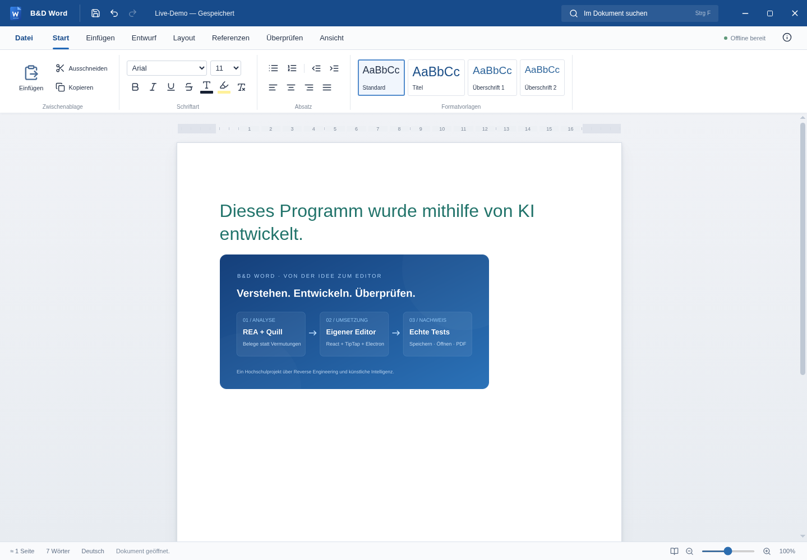

# B&D Word

Ein eigenständiger, Word-inspirierter Offline-Texteditor für eine Hochschulpräsentation über Reverse Engineering und KI. **Kein Microsoft-Produkt und keine Rekonstruktion des Word-Quellcodes.** Die tatsächliche REA-Referenz ist der offene Editor **Quill 2.0.3**.



## Unter Windows starten

Die erzeugten Pakete liegen in `release/`:

- `B&D Word Setup 1.0.0.exe`: Installation für den aktuellen Benutzer, einschließlich Desktop-Verknüpfung.
- `B&D Word-1.0.0-win.zip`: vollständig entpacken und `B&D Word.exe` starten. Alle mitgelieferten Dateien müssen im entpackten Ordner bleiben.

Die Anwendung benötigt zur Laufzeit weder Node.js noch Microsoft Word, Internet oder einen KI-Dienst. Das Demo-Bild liegt neben der Anwendung unter `Demo/demo-bild.png`. Ein Windows-11-Start-/Installationstest und der physische Drucktest stehen noch aus; die Entwicklung und automatisierten Electron-Funktionstests liefen unter Linux. Die Pakete sind nicht digital signiert.

## Entwicklung

Node.js **24.19.0** und npm verwenden. Im Repository:

```sh
npm ci
npm run desktop
```

`desktop` baut zuerst das Frontend und startet anschließend Electron. `npm run dev` startet nur das Web-Frontend; native Datei-, Bild-, PDF- und Druckdialoge benötigen Electron. Es gibt keinen Serverdienst und keine Zugangsdaten.

```sh
npm run build          # TypeScript-Prüfung + Vite-Produktionsbuild
npm test               # Browser- und echte Linux-Electron-Integrationstests
npm run dist:win       # Windows-x64-ZIP und NSIS-Installer
npm run dist:win:zip   # nur das Windows-ZIP
```

Die Tests benötigen einen Chromium-Browser, eine grafische Sitzung für Electron sowie `pdfinfo` und `pdftotext` aus Poppler. Unter Linux ohne Bildschirm unterstützt `scripts/cloud-xorg.conf` den vorhandenen Xorg-Dummy-Treiber. `PLAYWRIGHT_CHROMIUM_EXECUTABLE` kann den Browserpfad vorgeben; sonst wird `/usr/bin/chromium` verwendet, falls vorhanden. Testartefakte liegen unter `test-results/`.

Für diese Cloud liegt ein wiederholbares Installationsskript unter `scripts/cloud-install.sh`. Es nutzt beschreibbare Caches und den vorhandenen HTTPS-Proxy. TLS-, Paket- und Electron-Prüfsummen bleiben aktiviert. Auf einem normalen Windows-Entwicklungsrechner genügen `npm ci` und `npm run desktop`.

## Funktionen und Grenzen

| Bereich | Implementiert | Einschränkung |
| --- | --- | --- |
| Bearbeiten | Fett, kursiv, unterstrichen, durchgestrichen, Schrift und Größe, Farbe, Hervorhebung, Absatz-Ausrichtung, Einzüge, Listen, Überschriften, Undo/Redo | Keine vollständige Word-Formatvorlagenverwaltung |
| Einfügen | Lokale Rasterbilder, Tabellen mit zusätzlichen Zeilen/Spalten, Links, Seitenumbrüche | Kein Bildzuschnitt, keine frei schwebenden Objekte; Links werden bearbeitet, nicht automatisch extern geöffnet |
| Dateien | Neu, Öffnen, Speichern, Speichern unter; versioniertes `.bdword`-Format | Kein `.doc`-Import; keine automatische Wiederherstellung nach Absturz |
| Austausch | DOCX-Import/Export, HTML-/Textimport, PDF-Export, Betriebssystem-Druckdialog | DOCX ist verlustbehaftet: keine Layouttreue, Kopf-/Fußzeilen, Kommentare, Felder oder komplexen Listen; Bilder beim DOCX-Export nur PNG/JPEG/GIF |
| Ansicht | A4-Arbeitsfläche, Zoom, Lineal, Wortzahl, Suche, Gliederung | Fließender Bildschirmeditor, keine echten Bildschirm-Seiten; Status-Seitenzahl ist eine Schätzung |
| Offline | Eingebettete Bilder und lokal gebündelte Programmbestandteile | Externe/relative Bilder in HTML werden entfernt; verfügbare Schriftarten hängen vom Rechner ab |

Dateien sind auf 40 MB, einzelne eingefügte Bilder auf 10 MB begrenzt. HTML und DOCX-Inhalte werden vor der Übernahme bereinigt. `.bdword`-Dokumente werden vor dem Öffnen auf Formatversion und Editorstruktur geprüft. Ungespeicherte Änderungen lösen vor Neu/Öffnen/Schließen eine Rückfrage aus. Das eigene Format erhält die vom Editor unterstützte Dokumentstruktur; es ist keine DOCX-Datei.

## Architektur

- `src/App.tsx`: React-Oberfläche, Menüband, Dialogzustände und Editoraktionen.
- `src/extensions.ts`: echte Seitenumbrüche und Absatzeinzüge als Erweiterungen.
- `src/documents.ts`: Dokumentvalidierung, HTML-Bereinigung und DOCX-Konvertierung.
- `electron/main.cjs`: Fenster, lokale Dateidialoge und Dateioperationen, PDF/Druck.
- `electron/preload.cjs`: eng begrenzte Brücke zwischen Oberfläche und Betriebssystem.
- `scripts/brand-windows.cjs`: eigenes Icon und Produktinformationen im generierten Windows-Programm; Inventar für die Deinstallation.
- `scripts/installer.nsi`: Offline-Installer ohne Wine-Abhängigkeit; unbekannte Dateien im Installationsordner werden beim Deinstallieren nicht gelöscht.

Der Renderer hat keinen Node.js-Zugriff. Kontextisolation, Sandbox und eine Content Security Policy sind aktiv. Programmcode, Grafik und Oberfläche wurden eigenständig entwickelt; die grundlegende Textverarbeitung stammt aus TipTap/ProseMirror. Die unterstützten Tastenkürzel umfassen Strg+S, Strg+Umschalt+S, Strg+O, Strg+N, Strg+P, Strg+F, Strg+B/I/U, Strg+Z und Strg+Umschalt+Z sowie Strg+Enter für Seitenumbrüche.

## Nachvollziehbare REA-Analyse

```sh
npm --prefix analysis-tools ci
npm run analyze
```

Die Toolversionen sind separat gesperrt. Das Skript untersucht einen unverändert kopierten Ausschnitt der ausgelieferten Quill-Dateien mit erhaltener Verzeichnisstruktur. Es speichert Version, vollständige Analyse, Feature-Trace und Aufrufprotokoll unter `docs/analysis/reproduced/`. Die ursprünglichen Untersuchungen bleiben zusätzlich erhalten. Keine Microsoft-Anwendung wird dafür benötigt.

- [Analysebericht](REVERSE_ENGINEERING_REPORT.md)
- [Lernorientierte Erklärung](BD_WORD_ERKLAERT.md)
- [Zweiminütige Live-Demo und Windows-Checkliste](docs/LIVE_DEMO.md)
- [Validierung und offene Plattformtests](docs/VALIDIERUNG.md)
- [Fremdsoftware-Lizenzen](docs/THIRD_PARTY_NOTICES.txt)
